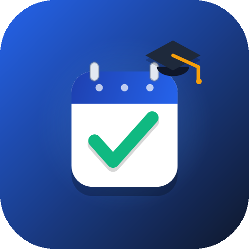

# AttendWise - College Lecture Attendance Tracker

<p align="center">
  
</p>

<p align="center">
  <b>A real-time, cloud-synced college attendance tracker built with Jetpack Compose & Firebase.</b>
</p>

<p align="center">
  
  
  
  
  
</p>

---

## 📌 Overview

**AttendWise** is an intelligent, modern Android application engineered to help university and college students take full control of their academic schedules, track lecture attendance in real time, and protect themselves against debarment with automated attendance calculations.

Built natively using modern **Jetpack Compose (Material 3)** and powered by **Google Firebase Authentication & Cloud Firestore**, every single subject, timetable schedule, and marked lecture syncs instantaneously across devices.

---

## ✨ Features

- 🔐 **One-Tap Google SSO Login**:
  - Secure authentication via Google Sign-In and Firebase Auth.
  - No legacy password forms or credentials stored locally.
  - Automated cloud user profile provisioning on first sign-in.

- 🗓️ **Custom Academic Terms & Semesters**:
  - Real-time semester switcher with quick picks (*Monsoon 2026*, *Winter 2026*, *Spring 2026*, *Summer 2026*) or custom terms.
  - Persistent to Cloud Firestore under user settings.

- 📅 **Academic Week Navigation (Weeks 1–20)**:
  - Stepper navigation `< Academic Week X >` with next/previous chevrons and a direct week jump picker.
  - Clean detachment from standard calendar dates, matching university semester weeks.

- ⏰ **Static Campus Schedule (MON – SAT, 8 AM – 7 PM)**:
  - 6-day static timetable tabs (`MON`, `TUE`, `WED`, `THU`, `FRI`, `SAT`) with today indicator.
  - Campus lecture operating hours bounded strictly between **8:00 AM and 7:00 PM**.

- 📊 **75% Attendance Threshold & Risk Alerting**:
  - Continuous evaluation against campus debarmant rules (minimum 75% required).
  - Categorizes courses into **Safe Standing (≥85%)**, **Caution (75–85%)**, and **Critical (<75%)**.
  - **Safe Bunk Calculator**: Calculates exactly how many classes you can afford to miss safely, or how many consecutive classes you must attend to restore compliance.

- 📝 **Streamlined Course Creation**:
  - Add courses with Course Code, Course Title, Lecture Hall / Room, Lecture Day, and Start/End times.

- 🎨 **Adaptive Material 3 Branding**:
  - Custom Android adaptive icon featuring an attendance calendar sheet, emerald checkmark, and academic graduation cap.
  - Full system dark mode and dynamic theme integration.

---

## 🛠️ Tech Stack

- **Framework**: Jetpack Compose (Material 3, Flow, Coroutines)
- **Language**: Kotlin 2.0+
- **Architecture**: MVVM with Repository Pattern & Reactive StateFlow
- **Authentication**: Firebase Authentication (Google SSO with SHA-1/SHA-256 fingerprinting)
- **Database**: Cloud Firestore (NoSQL real-time document listeners)
- **Tooling**: Android Gradle Plugin, Gradle 9.x, Android SDK 35 (Android 15 target)

---

## 🚀 Getting Started

### Prerequisites
- Android Studio Ladybug / Meerkat (or newer)
- JDK 17+
- Android Device or Emulator running Android 8.0+ (API 26+)

### Installation

1. **Clone the repository**:
   ```bash
   git clone https://github.com/devesh-chavda/AttendWise-AGY.git
   cd AttendWise-AGY
   ```

2. **Open in Android Studio**:
   - Open the `AttendWiseApp` subfolder in Android Studio.
   - Allow Gradle to sync dependencies.

3. **Firebase Setup**:
   - The project is configured with Firebase `google-services.json`.
   - Ensure your SHA-1 and SHA-256 signing fingerprints are registered in your Firebase Console under Google Sign-In settings.

4. **Build & Run**:
   ```bash
   cd AttendWiseApp
   ./gradlew assembleDebug
   ```

---

## 📄 License

This project is licensed under the MIT License - see the [LICENSE](LICENSE) file for details.
